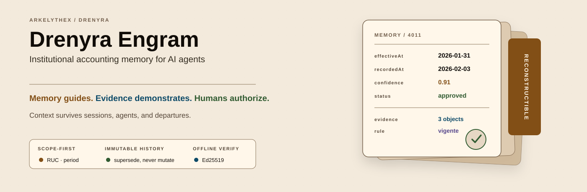
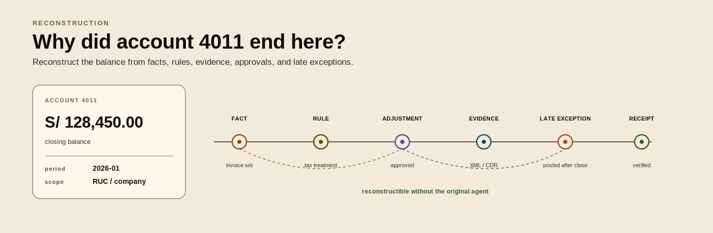
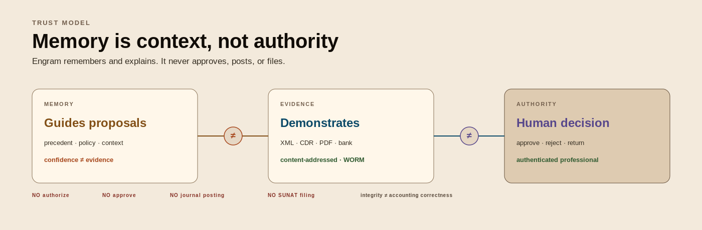
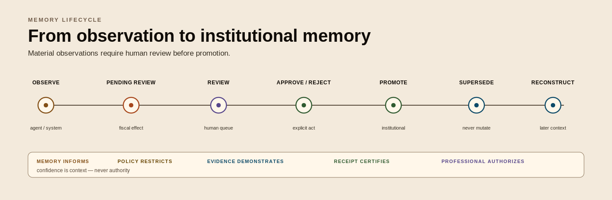

<!-- markdownlint-disable-next-line MD041 -->
<a id="top"></a>

<div align="center">

<picture>
  <source media="(prefers-color-scheme: dark)" srcset="assets/branding/drenyra-engram-hero-archive-dark.png" />
  <source media="(prefers-color-scheme: light)" srcset="assets/branding/drenyra-engram-hero-archive.png" />
  
</picture>

<h1>Drenyra Engram</h1>

<p><strong>Institutional accounting memory for AI agents.</strong></p>

<p>


<a href="LICENSE"></a>
</p>

<p>
<a href="#start-in-60-seconds"><strong>Quickstart</strong></a> &bull;
<a href="docs/README.md"><strong>Docs</strong></a> &bull;
<a href="examples/README.md"><strong>Examples</strong></a> &bull;
<a href="DOCS.md"><strong>Reference</strong></a> &bull;
<a href="contracts/README.md"><strong>Contracts</strong></a> &bull;
<a href="ROADMAP.md"><strong>Roadmap</strong></a>
</p>

<br/>

<p>
Six months after a close, someone asks <em>why</em> account 4011 ended where it did.<br/>
The agent that did the work is gone. The chat is gone. The context is gone.<br/>
<strong>Drenyra Engram keeps it, scoped, signed, and reconstructible.</strong>
</p>

<p><sub>Scope-first · immutable history · offline verification · one Go binary · local SQLite</sub></p>

</div>

---

## What it is, and what it is not

Drenyra Engram is a local Go engine for recording, retrieving, and reviewing
scope-bound accounting memories. It keeps immutable revision chains, links
context to evidence and rules, and exposes one engine through a CLI, MCP, and
HTTP. It preserves the context around an accounting decision after the
original agent, session, or contributor is gone.

| Engram is | Engram is not |
| --- | --- |
| A scope-first store for accounting memories, revisions, evidence links, rule links, and review state | A general ledger or the source of truth for balances |
| A local engine with CLI, MCP, and HTTP adapters | A journal-posting, payment, declaration, or SUNAT filing system |
| A record of its own immutable acts, with Ed25519 receipts and offline verification | A claim that a decision, accounting treatment, or tax outcome is correct |
| A human-gated review workflow for fiscally material memories | A replacement for professional judgment, compliance review, or business authorization |

<p align="center">
<picture>
  <source media="(prefers-color-scheme: dark)" srcset="assets/branding/drenyra-engram-reconstructible-context-dark.png" />
  <source media="(prefers-color-scheme: light)" srcset="assets/branding/drenyra-engram-reconstructible-context.png" />
  
</picture>
</p>

## The trust boundary

> **Memory guides. Evidence demonstrates. Policy restricts. A professional
> approves a memory review.**

<p align="center">
<picture>
  <source media="(prefers-color-scheme: dark)" srcset="assets/branding/drenyra-engram-trust-boundary-dark.png" />
  <source media="(prefers-color-scheme: light)" srcset="assets/branding/drenyra-engram-trust-boundary.png" />
  
</picture>
</p>

An agent can record a proposal or context; it cannot supply authority. A
fiscally material memory enters `pending_review`. A verified professional may
approve that specific review envelope, subject to membership, scope, role,
assurance, separation-of-duties, and policy checks. The engine records the
review; it does not authorize a business operation.

`accounting_approve` is a **memory-review approval** tool, not a
business-authorization tool. Its arguments never carry identity: the principal
comes from an authenticated session. The stdio MCP server has no session, so
the tool fails closed there with `AUTHENTICATION_REQUIRED`. An agent cannot
turn a claimed identity into approval authority, and
[`examples/mcp`](examples/mcp/quickstart.sh) shows it trying.

## Start in 60 seconds

You need Go 1.26 or later and `curl`. Build the binary from a clone, then run
every adapter against a throwaway workspace with synthetic data:

```bash
git clone https://github.com/arkelythex/drenyra-engram.git
cd drenyra-engram
bin_dir="$(mktemp -d)"
go build -o "$bin_dir/drenyra-engram" ./cmd/drenyra-engram
DRENYRA_ENGRAM_BIN="$bin_dir/drenyra-engram" bash examples/run-all.sh
```

You will see a scoped save and search, a scope miss in another period, a
signed receipt verified offline, 58 MCP tools listed, an agent approval
refused, and the HTTP adapter rejecting a request without its token. Nothing
outside the temporary directory is touched.

| Next | Read |
| --- | --- |
| A guided first result, step by step | [Getting started](docs/GETTING-STARTED.md) |
| Connect an MCP client or HTTP program | [Connecting agents and programs](docs/CONSUMING.md) · [client config](examples/mcp/client-config.json) |
| Choose a runtime mode before writing data | [Troubleshooting → runtime mode](docs/TROUBLESHOOTING.md#runtime-mode) |
| Release binaries and containers | [Installation](docs/INSTALLATION.md) |

> **Runtime mode matters.** With `DRENYRA_FISCAL_RUNTIME_MODE` unset, the
> store starts in fail-closed `shadow` mode and rejects company-scoped
> protected writes. Deployments choose `enforce`; the examples use
> `legacy_compat` locally and say so.

## How a memory lives

<p align="center">
<picture>
  <source media="(prefers-color-scheme: dark)" srcset="assets/branding/drenyra-engram-memory-lifecycle-dark.png" />
  <source media="(prefers-color-scheme: light)" srcset="assets/branding/drenyra-engram-memory-lifecycle.png" />
  
</picture>
</p>

- **Scope is structural.** Organization, company, RUC, and period form the
  exact scope. Reads and mutations apply it before search ranking or state
  changes; a query for one company never ranks another company's memory.
- **History is immutable.** A change is a new revision or a supersession,
  never an edit. Terminal states do not reopen.
- **Time is explicit.** `effectiveAt`, `recordedAt`, and `observedAt` keep a
  late event affecting a closed period visible as late.
- **Evidence is content-addressed.** Artifact bytes live in a local WORM store
  keyed by SHA-256, with policy-backed retention, holds, and approved purge.

## Verify, don't trust

Covered acts get an Ed25519-signed receipt in a per-subject hash chain.
`verify` checks them offline and read-only, layer by layer:

```text
payload canonicalization · envelope integrity · signature · signing-key validity
tenant/company scope · chain link · principal provenance · supersession chain
evidence availability · object availability · rule availability · fiscal scope binding
```

Every report ends the same way:

```json
"accountingCorrectness": "Accounting correctness: NOT ASSERTED"
```

A valid receipt proves that nobody altered the act and who performed it. It
never proves that the accounting is right. That judgment stays with a
professional. See the [verification contract](contracts/verification.md).

## One engine, three adapters

```text
CLI ──────┐
MCP ──────┼──> shared Go API ──> scope-first SQLite store (schema v18)
HTTP ─────┘                        ├── immutable memory revisions
                                   ├── Ed25519-signed receipts
                                   └── content-addressed evidence objects
```

One binary, pure-Go SQLite, no CGO and no external services. All three
adapters call the same engine, so there is one authorization model rather
than three. Schema migrations are additive, and a store written by a newer
engine is refused rather than guessed at.

| Surface | Start it | Reference |
| --- | --- | --- |
| CLI | `drenyra-engram <command>` | [CLI reference](DOCS.md#cli-reference) |
| MCP (stdio) | `drenyra-engram mcp --db <path>` | [MCP tools](DOCS.md#mcp-tools) |
| HTTP + MCP over HTTP | `drenyra-engram serve --token <secret>` | [HTTP API](DOCS.md#http-api) |

## For agents

An agent connected over MCP should treat Engram as institutional memory with
hard edges:

1. **Always pass the exact scope.** `organizationId`, `companyId`, `ruc`, and
   `period`. Missing scope fails; a wrong scope finds nothing, by design.
2. **Record the why, not just the what.** `content` carries `what`, `why`,
   `where`, and `learned`; a future reviewer reconstructs the decision from it.
3. **Propose; never decide.** Judgments and reconciliations are proposals. Any
   fiscal effect other than `none` sends the memory to human review.
4. **Read before you write.** Search the scope and the topic history first, so
   a new memory supersedes the right chain instead of forking it.
5. **Never treat confidence as evidence.** Confidence is context; evidence
   objects and receipts are what demonstrate.

The 58 tools are grouped by family in the [MCP reference](DOCS.md#mcp-tools).

## Maturity

**Status: alpha.** The repository demonstrates a local accounting-memory
kernel: scoped storage, immutable lifecycle records, authenticated professional
review paths, receipts, offline verification, and local evidence objects. It
does not demonstrate production readiness, a validated customer workflow,
regulatory compliance, a certification, or an ERP or SUNAT integration.

The [roadmap](ROADMAP.md) lists the open readiness gates and explicit
deferrals; the [compatibility guide](docs/COMPATIBILITY.md) states what is
supported today.

## Documentation

| You are | Start here |
| --- | --- |
| Evaluating whether it fits | [Product](docs/PRODUCT.md) · [Getting started](docs/GETTING-STARTED.md) · [Data, security, and privacy](docs/DATA-SECURITY-PRIVACY.md) |
| Integrating a client or service | [Installation](docs/INSTALLATION.md) · [Consuming Engram](docs/CONSUMING.md) · [Examples](examples/README.md) · [Reference](DOCS.md) |
| An accounting professional or reviewer | [Approval contract](contracts/approval.md) · [Verification contract](contracts/verification.md) · [Trust model](docs/architecture/trust-model.md) |
| Operating a deployment | [Data, security, and privacy](docs/DATA-SECURITY-PRIVACY.md) · [Troubleshooting](docs/TROUBLESHOOTING.md) · [Compatibility](docs/COMPATIBILITY.md) |
| Contributing | [Contributing](CONTRIBUTING.md) · [Architecture](docs/ARCHITECTURE.md) · [Codebase guide](docs/CODEBASE-GUIDE.md) · [Contracts](contracts/README.md) |

The full map, by audience and content type, is the
[documentation index](docs/README.md).

## Part of the Drenyra ecosystem

Drenyra Engram participates in the
[Drenyra Dominion Program](https://github.com/arkelythex/drenyra-ai/tree/main/program/drenyra-dominion),
the federated program master that fixes vision, authority, contracts,
dependencies, gates, and sequencing across Drenyra repositories. Each
repository keeps its own implementation, versioning, and tests, and references
the master instead of copying its specs.

| SDD | Engram's role |
| --- | --- |
| [SDD-080 — Engram Institutional Memory](https://github.com/arkelythex/drenyra-ai/tree/main/program/drenyra-dominion/sdds/sdd-080-engram) | Institutional memory: prior decisions and context, scope-first and offline-verifiable (this repository) |
| [SDD-050 — Peruvian Monthly Close](https://github.com/arkelythex/drenyra-ai/tree/main/program/drenyra-dominion/sdds/sdd-050-monthly-close) | Supplies prior-decision context to the close journey; informs only |

Ecosystem-side evidence lives in
[capabilities and conformance](docs/ecosystem/capabilities-and-conformance.md)
and [Dominion integration](docs/ecosystem/dominion-integration.md). Diagrams
follow the
[ecosystem diagram convention](https://github.com/arkelythex/drenyra-ai/blob/main/docs/documentation-standard.md#5-diagrams).

## Contributing and security

Read [CONTRIBUTING.md](CONTRIBUTING.md) before opening a change: contracts,
the Go engine, the TypeScript reference mirror, and golden vectors move
together. Use synthetic data only, everywhere. Report vulnerabilities
privately as described in [SECURITY.md](SECURITY.md). Participation follows
the [Code of Conduct](CODE_OF_CONDUCT.md).

## License

[Apache License 2.0](LICENSE).

<div align="center"><sub><a href="#top">Back to top ↑</a></sub></div>
